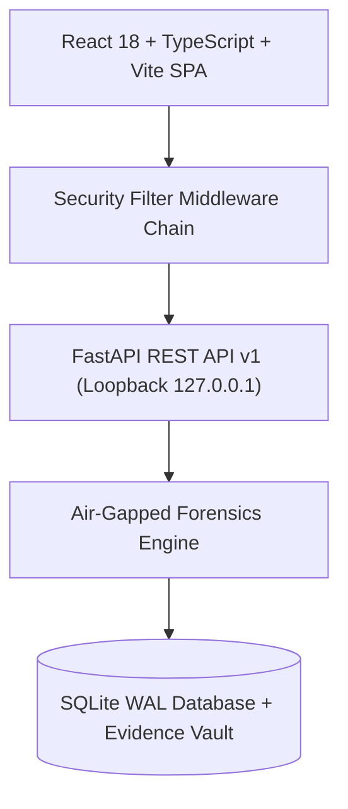

# PhishGuard — Professional Defensive Phishing Email & URL Threat Analysis Platform

> **"Analyze. Detect. Protect."**  
> A professional, defensive cybersecurity platform engineered for incident responders, SOC analysts, and digital forensics specialists to inspect suspicious emails, MIME components, header routing hops, unverified authentication claims, and URLs without interacting with adversarial infrastructure.

---

## 1. Project Overview & Identity

- **Project Name:** PhishGuard
- **Project Number:** 04
- **Project Type:** Defensive Email Security & Phishing Threat Analysis Platform
- **Project Directory:** `04-PhishGuard-Email-URL-Analyzer`

PhishGuard analyzes user-submitted suspicious emails and URL strings in an isolated, air-gapped environment. The platform never resolves target hostnames during analysis, never executes attachments, and never renders active scripts or remote tracking assets.

### Core Defensive Capabilities:
1. **Air-Gapped Ingestion:** Safe RFC 5322 parsing of `.eml` uploads and pasted headers with SHA-256 and MD5 cryptographic fingerprinting.
2. **Chronological Hop Routing Forensics:** Traverses in-transit routing hops (`Received:`), measures transit latency, flags negative clock skews, and classifies RFC 1918 private vs public IP relays.
3. **Sender Alignment & Impersonation:** Identifies envelope mismatches (`From:`, `Reply-To:`, `Return-Path:`), display-name email spoofing, and detects brand impersonation against high-value targets (PayPal, Microsoft, Apple, Google, Amazon).
4. **Air-Gapped DKIM Verification & Auth Claims Auditing:** RFC 6376 compliant offline cryptographic verification engine (`OfflineDkimVerifier`) verifying RSA-SHA256 digital signatures using imported local DNS TXT zone snapshots stored in SQLite, combined with defensive skepticism auditing for SPF and DMARC claims.
5. **Static URL Threat Inspection:** RFC 3986 normalization, offline Public Suffix List (PSL) domain extraction, Punycode/homoglyph decoding (`xn--`), mixed Cyrillic/Greek script detection, Shannon entropy calculations, and open redirect parameter extraction.
6. **Pure-Python Local YARA Engine & Attachment Forensics:** In-memory defensive signature scanner (`LocalYaraScanner`) detecting embedded PEs (`SUSPICIOUS_EMBEDDED_PE`), obfuscated PowerShell cradles, VBA auto-execution macros, HTML smuggling payloads, and script downloader objects without native C compiler dependencies or binary execution risks.
7. **Explainable Mathematical Risk Scoring:** Category-grouped asymptotic diminishing returns formula ($S_c = \text{Cap}_c \times [1 - \prod(1 - \frac{W_r \times \text{Conf}_r}{\text{Cap}_c + 15})]$) with a Multi-Vector Corroboration Guardrail preventing isolated heuristics from reaching Critical severity ($>85$).
8. **Deterministic Detection Catalog:** 27 heuristic rules seeded in SQLite with direct MITRE ATT&CK Enterprise Matrix mappings.
9. **SOC Case Management & Incident Response:** Triage workbench supporting case creation, severity tracking, status lifecycles (`open`, `in_review`, `resolved`, `closed`), chronological analyst notes, and artifact correlation.
10. **OASIS STIX 2.1 Threat Exporter & Multi-Format Reports:** Exports standardized STIX 2.1 JSON bundles (`application/stix+json;version=2.1`) for SIEM/SOAR ingestion, cryptographically hashed ReportLab PDF reports with defanged text and zero active links, formula-escaped CSV exports, and structured JSON telemetry.
11. **Append-Only Audit Logging:** Immutable chronological event logging conforming to NIST SP 800-92 standards.

---

## 2. System Architecture & Tech Stack



- **Frontend:** React 18, TypeScript (strict mode), Vite 6, Tailwind CSS, Lucide React.
- **Backend:** Python 3.11+ (Python 3.14 verified), FastAPI, Pydantic v2, SQLAlchemy 2.0, Alembic.
- **Database:** SQLite 3 in Write-Ahead Logging (WAL) mode with strict foreign keys.
- **Security & Isolation:** Loopback binding (`127.0.0.1`), `TrustedHostMiddleware`, strict Origin matching, custom header CSRF defense (`X-PhishGuard-Client: web-console`), streaming 10 MB upload bounds, and offline socket interception.

---

## 3. Directory Structure

```text
04-PhishGuard-Email-URL-Analyzer/
├── backend/
│   ├── alembic/                  # Database migration scripts & env
│   ├── app/
│   │   ├── api/v1/               # Versioned REST API endpoints (health, overview, emails, urls, cases, etc.)
│   │   ├── attachment_analysis/  # Attachment metadata & extension forensics
│   │   ├── core/                 # Settings, structured logging, security middleware
│   │   ├── database/             # SQLite engine, sessions, seed catalog
│   │   ├── detection/            # Deterministic rule engine & MITRE catalog
│   │   ├── email_analysis/       # RFC 5322 parser, hop analyzer, auth claim auditor
│   │   ├── models/               # SQLAlchemy 2.0 declarative models (12 tables)
│   │   ├── reports/              # ReportLab PDF exporter, CSV exporter, JSON generator
│   │   ├── schemas/              # Pydantic v2 validation models
│   │   ├── scoring/              # Diminishing returns mathematical calculator
│   │   ├── services/             # Orchestration (Analysis, Case, Audit, Reports)
│   │   └── url_analysis/         # RFC 3986 normalizer, offline PSL, homoglyphs
│   ├── tests/                    # Automated unit, integration, and security test suite (46 tests)
│   └── requirements.txt          # Python dependencies
├── data/
│   ├── evidence/                 # Read-only preserved email evidence vault
│   └── reports/                  # Server-generated analysis and case reports
├── docs/                         # Comprehensive 18-document engineering suite
│   ├── PRD.md                    # Product Requirements Document
│   ├── TRD.md                    # Technical Requirements Document
│   ├── ARCHITECTURE.md           # System Architecture & Component Diagrams
│   ├── APP_FLOW.md               # User & Analyst Investigation Flow
│   ├── UI_UX_DESIGN_BRIEF.md     # Design System, WCAG 2.2 AA & Palette
│   ├── DATABASE_SCHEMA.md        # Relational Schema & Mermaid ER Diagram
│   ├── API_SPECIFICATION.md      # OpenAPI / REST Endpoints Specification
│   ├── SECURITY_REQUIREMENTS.md  # OWASP ASVS, NIST & Defensive Controls
│   ├── THREAT_MODEL.md           # STRIDE Threat Modeling & Mitigations
│   ├── SECURITY_VERIFICATION_MATRIX.md # Verification Matrix & Scans
│   ├── TESTING_STRATEGY.md       # Pytest & Vitest QA Plan
│   ├── IMPLEMENTATION_PLAN.md    # Stage Execution Record & Milestones
│   ├── DEPLOYMENT_GUIDE.md       # Local, Loopback & Container Deployment
│   ├── CI_CD_GUIDE.md            # GitHub Actions Pipeline Guide
│   ├── RISK_REGISTER.md          # Qualitative Risk Register & Mitigations
│   ├── CHANGELOG.md              # Semantic Versioning History
│   ├── SECURITY_AUDIT_REPORT.md  # Bandit AST Audit & Vulnerability Report
│   └── SECURITY_FINDINGS.md      # Triaged Vulnerabilities & Hardening Log
├── frontend/
│   ├── src/
│   │   ├── components/           # UI components (ScoreGauge, SeverityBadge, Navbar, etc.)
│   │   ├── pages/                # 7 SOC pages (Dashboard, Email, URL, Cases, Findings, Reports, Audit)
│   │   ├── services/             # Hardened API client with CSRF header enforcement
│   │   └── types/                # TypeScript shared interfaces
│   ├── tests/                    # Frontend Vitest smoke and component tests
│   └── package.json              # Frontend dependencies and scripts
├── .env.example                  # Environment variable configuration template
├── .gitignore                    # Git exclusions
├── pyproject.toml                # Tool configuration (Ruff, Pytest)
└── README.md                     # Master project documentation
```

---

## 4. Setup & Local Execution (Windows PowerShell)

### Prerequisites:
- Python 3.11+ (Python 3.14 verified)
- Node.js 18+ and npm 9+

### 1. Backend Setup:
```powershell
cd D:\Projects\04-PhishGuard-Email-URL-Analyzer

# Copy environment variables template
Copy-Item .env.example .env

# Install backend dependencies
python -m pip install -r backend/requirements.txt

# Run database migrations
cd backend
python -m alembic upgrade head
cd ..

# Start FastAPI backend engine on loopback (127.0.0.1:8000)
python -m uvicorn app.main:app --app-dir backend --host 127.0.0.1 --port 8000 --reload
```

### 2. Frontend Setup:
In a separate terminal window:
```powershell
cd D:\Projects\04-PhishGuard-Email-URL-Analyzer\frontend

# Install dependencies
npm install

# Start development server
npm run dev
```
Open your browser to `http://localhost:5173`. The live engine badge will indicate **Engine Status: HEALTHY**.

### 3. Production Frontend Build:
```powershell
npm --prefix "D:\Projects\04-PhishGuard-Email-URL-Analyzer\frontend" run build
```

---

## 5. Verification & Test Execution Results

### Backend Automated Test Suite (Pytest)
```powershell
python -m pytest "D:\Projects\04-PhishGuard-Email-URL-Analyzer\backend\tests" -v
```
**Result:** **63 passed in 1.87s (100% pass rate)**.  
Covers: Full investigation API lifecycle, MIME parsing, hop routing delays, negative clock skews, unverified auth claims, pure-Python local YARA signature matching, OASIS STIX 2.1 CTI bundles, air-gapped DKIM offline cryptographic verification (RSA-SHA256 / RSA-SHA1), local DNS cache snapshot API, static URL homoglyphs, attachment forensics, 27 detection rules, diminishing returns risk scoring, false-positive newsletter resistance, security headers, custom CSRF header enforcement, 10MB streaming upload limit, and offline socket interception.

### Frontend Component & Smoke Test Suite (Vitest)
```powershell
npm --prefix "D:\Projects\04-PhishGuard-Email-URL-Analyzer\frontend" run test
```
**Result:** **5 passed in 4.06s (100% pass rate)**.  
Covers: Application brand rendering, SOC dashboard console, tactical severity badges, risk score gauge, hop timeline visualizer, and multi-tab switching.

### AST Static Code Security Scan (Bandit)
```powershell
python -m bandit -r "D:\Projects\04-PhishGuard-Email-URL-Analyzer\backend\app"
```
**Result:** **5,292 lines of code scanned — 0 issues identified (0 High, 0 Medium, 0 Low)**.

---

## 6. Comprehensive Documentation Index

| Document | Path | Description |
| :--- | :--- | :--- |
| **Product Requirements** | [`docs/PRD.md`](docs/PRD.md) | Business requirements, user personas, functional & non-functional requirements. |
| **Technical Requirements** | [`docs/TRD.md`](docs/TRD.md) | Technical stack specifications, algorithms, memory bounds, SQLite pragmas. |
| **System Architecture** | [`docs/ARCHITECTURE.md`](docs/ARCHITECTURE.md) | Modular architecture, Mermaid component diagrams, data flow pipelines. |
| **Investigation Flow** | [`docs/APP_FLOW.md`](docs/APP_FLOW.md) | Step-by-step SOC analyst triage workflows and Mermaid state diagrams. |
| **UI/UX Design Brief** | [`docs/UI_UX_DESIGN_BRIEF.md`](docs/UI_UX_DESIGN_BRIEF.md) | Design tokens, WCAG 2.2 AA accessibility, color contrast, and component specs. |
| **Database Schema** | [`docs/DATABASE_SCHEMA.md`](docs/DATABASE_SCHEMA.md) | Complete 12-table SQLite schema, Mermaid ER diagram, columns, indexes, and cascades. |
| **REST API Specification** | [`docs/API_SPECIFICATION.md`](docs/API_SPECIFICATION.md) | OpenAPI REST routes, JSON payloads, custom CSRF header, and status codes. |
| **Security Requirements** | [`docs/SECURITY_REQUIREMENTS.md`](docs/SECURITY_REQUIREMENTS.md) | OWASP ASVS Level 2, NIST CSF 2.0, air-gap isolation, CSV injection defenses. |
| **STRIDE Threat Model** | [`docs/THREAT_MODEL.md`](docs/THREAT_MODEL.md) | Trust boundaries, STRIDE threat analysis, countermeasures, and residual risk. |
| **Security Verification** | [`docs/SECURITY_VERIFICATION_MATRIX.md`](docs/SECURITY_VERIFICATION_MATRIX.md) | Security controls mapped to automated tests and execution evidence. |
| **Testing Strategy** | [`docs/TESTING_STRATEGY.md`](docs/TESTING_STRATEGY.md) | Pytest & Vitest QA strategy, false-positive regression, and coverage breakdown. |
| **Implementation Plan** | [`docs/IMPLEMENTATION_PLAN.md`](docs/IMPLEMENTATION_PLAN.md) | Stage execution records, milestones, and deliverable tracking. |
| **Deployment Guide** | [`docs/DEPLOYMENT_GUIDE.md`](docs/DEPLOYMENT_GUIDE.md) | Local standalone setup, Docker Compose specification, and production hardening. |
| **CI/CD Guide** | [`docs/CI_CD_GUIDE.md`](docs/CI_CD_GUIDE.md) | GitHub Actions workflow configuration, linting, and automated testing gates. |
| **Risk Register** | [`docs/RISK_REGISTER.md`](docs/RISK_REGISTER.md) | NIST SP 800-30 qualitative risk register and residual risk ratings. |
| **Changelog** | [`docs/CHANGELOG.md`](docs/CHANGELOG.md) | Semantic versioning changelog across all development phases. |
| **Security Audit Report** | [`docs/SECURITY_AUDIT_REPORT.md`](docs/SECURITY_AUDIT_REPORT.md) | Bandit AST audit results, dependency posture, and security verification. |
| **Security Findings** | [`docs/SECURITY_FINDINGS.md`](docs/SECURITY_FINDINGS.md) | Triaged security findings, event loop resolution, and hardening records. |

---

## 7. Responsible Cybersecurity & Operational Scope

PhishGuard is designed exclusively for defensive security operations, educational research, and authorized incident response.
- All URL analysis is performed statically without outbound DNS or HTTP requests.
- All attachments are inspected purely via non-executing metadata and cryptographic hashing.
- PhishGuard contains zero offensive scanning capabilities, credential harvesting mechanisms, or exploitation vectors.
