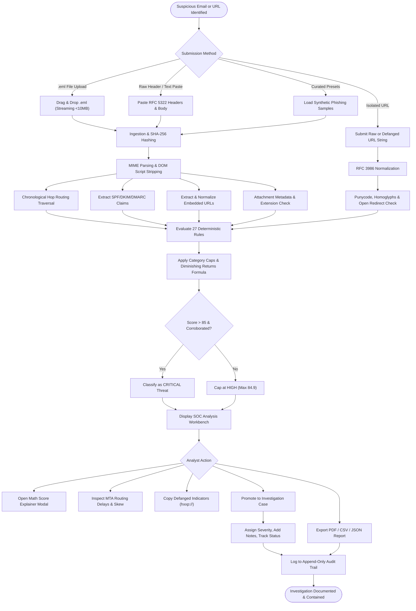

# Application Investigation Flow (APP_FLOW.md) — PhishGuard
## Project 04: Defensive Phishing Email & URL Threat Analysis Platform

---

### 1. Investigation Lifecycle Overview

PhishGuard provides an intuitive, security-first workflow designed to mirror standard SOC Tier 1/2 triage and Tier 3 digital forensics workflows.

---

### 2. Detailed Step-by-Step Operational Workflows

#### 2.1 Email Ingestion & Triage
1. **Analyst Entry:** The analyst navigates to the **Email Analyzer** tab.
2. **Input Selection:**
   - Option A: Drag and drop a suspicious `.eml` or `.msg` file into the upload zone.
   - Option B: Switch to the "Paste Raw Headers / Body" tab and paste raw RFC 5322 text.
   - Option C: Click "Load Synthetic Phishing Sample" to test a verified sample with spoofed headers, SPF/DKIM failures, and malicious attachments.
3. **Execution:** The analyst clicks "Execute Defensive Analysis". The frontend dispatches a multipart request with `X-PhishGuard-Client: web-console`.
4. **Immediate Output:** The workbench renders the calculated Phishing Risk Score, the tactical Severity Badge (`CRITICAL`, `HIGH`, `MODERATE`, `LOW`), and summary metadata.

#### 2.2 Forensic Inspection Sub-Tabs
- **Triggered Detections Tab:** Lists all activated heuristic rules with base weights, effective score contributions, remediation advice, and MITRE ATT&CK technique IDs.
- **Routing Hops Tab:** Presents a vertical chronological relay diagram from the client origin to the destination server, highlighting abnormal transit delays and private IP hops.
- **Auth Claims Tab:** Details SPF, DKIM, and DMARC claims with the prominent warning that upstream claims are unverified.
- **Extracted URLs Tab:** Shows all extracted links, flags IP literal hostnames, homoglyphs, and open redirect parameters.
- **Attachments Tab:** Details filename, declared MIME type, byte size, double extensions, and SHA-256 digests.

#### 2.3 URL Investigation Workflow
1. The analyst navigates to the **URL Analyzer** tab.
2. The analyst enters a target URL (e.g., `https://xn--pple-43d.com/login-verification`).
3. The engine normalizes the string, strips credentials, parses registrable domains via the offline PSL, and checks for brand impersonation.
4. The analyst inspects structural metrics (Shannon entropy, character length) and evasion flags without issuing any HTTP requests.

#### 2.4 Incident Promotion & Case Management
1. From any analysis run, the analyst clicks **"Create Investigation Case"**.
2. PhishGuard auto-populates the case title with the subject or target hostname, links the `analysis_run_id` as an immutable artifact, and navigates to the **Cases** view.
3. The analyst logs investigative hypotheses, tracks status transitions (`open` $\rightarrow$ `in_review` $\rightarrow$ `resolved`), and attaches additional notes.

#### 2.5 Evidence Export & Compliance Reporting
1. The analyst selects **Export Report** and chooses between:
   - **PDF:** Defanged ReportLab layout suitable for executive briefings and legal discovery.
   - **CSV:** Escaped tabular summary ready for SIEM ingestion or spreadsheet analysis without formula execution risks.
   - **JSON:** Complete machine-readable evidentiary payload.
2. The export event and SHA-256 checksum are committed to the **Audit Trail**.

