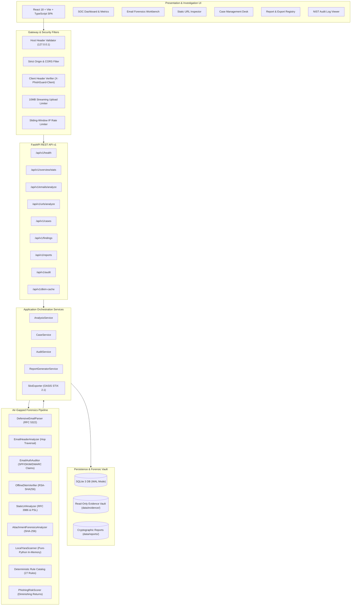
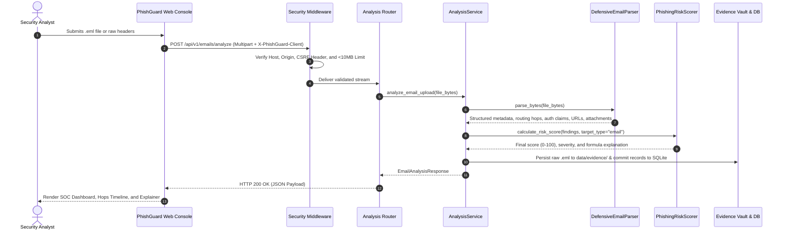

# System Architecture — PhishGuard
## Project 04: Defensive Phishing Email & URL Threat Analysis Platform

---

### 1. High-Level Architecture Overview

PhishGuard employs a modular, air-gapped, defense-in-depth architecture. The platform cleanly segregates user interaction, defensive forensic parsing, deterministic detection rules, and persistent evidence storage.

---

### 2. Component Subsystem Details

#### 2.1 Presentation Layer (Frontend SPA)
- Built with React 18, Vite, and TypeScript in strict mode.
- Communicates with the backend exclusively via `frontend/src/services/api.ts`.
- Automatically attaches the mandatory custom client header `X-PhishGuard-Client: web-console` on all state-changing HTTP requests.
- Contains dedicated components:
  - `RoutingHopsVisualizer`: Interactive chronological timeline of MTAs and transit delays.
  - `AuthClaimsBadge`: Visual indicators for SPF, DKIM, and DMARC with explicit "Unverified Header Claim" warnings.
  - `ScoreGauge` & `ScoreExplainerModal`: Real-time visual risk gauge with transparent mathematical formula auditing.
  - `SeverityBadge`: Standardized tactical severity indicators (`critical`, `high`, `moderate`, `low`).

#### 2.2 Security Middleware Pipeline
Requests traverse a five-stage defensive middleware chain before entering route handlers:
1. **TrustedHostMiddleware:** Enforces loopback host headers (`127.0.0.1`, `localhost`).
2. **CORS / Origin Enforcement:** Restricts HTTP origins strictly to configured development and production frontend hosts.
3. **Custom Client CSRF Header Verification:** Requires `X-PhishGuard-Client: web-console` on all `POST`, `PUT`, `PATCH`, and `DELETE` requests.
4. **StreamingUploadLimitMiddleware:** Evaluates `Content-Length` immediately and wraps the ASGI byte stream to reject payloads $>10$ MB in real time.
5. **Sliding-Window Rate Limiter:** Protects loopback endpoints against automated resource exhaustion.

#### 2.3 Forensic Analysis Engine
- **DefensiveEmailParser:** Parses RFC 5322 bytes into normalized headers, sanitizes HTML via lxml, defangs embedded links, and extracts attachment metadata.
- **EmailHeaderAnalyzer:** Reconstructs relay chains from `Received:` headers, measures transit delays, flags negative clock skews, and verifies sender identity alignments (`From:` vs `Reply-To:`, `From:` vs `Return-Path:`).
- **EmailAuthenticationAuditor:** Scrapes `Authentication-Results:` headers and isolates claims without trusting upstream validity.
- **StaticUrlAnalyzer:** Normalizes URLs to RFC 3986, extracts registrable domains using the offline PSL, detects Punycode and mixed-script homoglyphs, computes Shannon entropy, and flags open redirect queries.
- **AttachmentForensicsAnalyzer & LocalYaraScanner:** Inspects filenames, flags double extensions (`.pdf.exe`), identifies script/macro/disk image extensions, records SHA-256 fingerprints, and executes pure-Python in-memory YARA pattern matching for PE headers, obfuscated PowerShell cradles, VBA macro execution hooks, HTML smuggling blobs, and script downloader objects without native C toolchains or execution risks.
- **OfflineDkimVerifier:** Verifies RFC 6376 DKIM digital signatures offline using local SQLite DNS TXT snapshot records (`DkimDnsRecord`), computing body hashes and verifying RSA-SHA256/RSA-SHA1 cryptographic signatures with zero outbound DNS traffic.
- **OASIS STIX 2.1 Threat Exporter:** Exports comprehensive CTI bundles with standardized indicators, MITRE ATT&CK attack-patterns, and relationship graphs for SIEM/SOAR ingestion.
- **Deterministic Rule Catalog & Engine:** Evaluates 27 static heuristic rules mapped to MITRE ATT&CK techniques.
- **PhishingRiskScorer:** Computes asymptotic diminishing returns category contributions and verifies multi-vector corroboration before assigning Critical risk scores.

---

### 3. Data Flow Diagram: Email Analysis Pipeline

