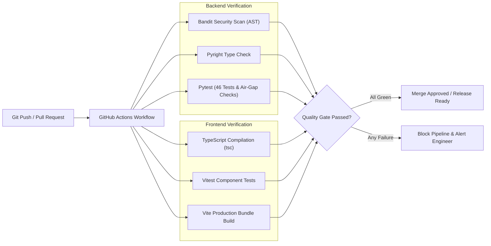

# Continuous Integration & Delivery Guide (CI_CD_GUIDE.md) — PhishGuard
## Project 04: Defensive Phishing Email & URL Threat Analysis Platform

---

### 1. CI/CD Architecture Overview

PhishGuard employs an automated GitHub Actions pipeline designed to enforce code quality, strict static type checking, security audits, and functional test execution on every pull request and push to main.



---

### 2. GitHub Actions Workflow Configuration (`.github/workflows/ci.yml`)

```yaml
name: PhishGuard CI/CD Pipeline

on:
  push:
    branches: [ main, develop ]
  pull_request:
    branches: [ main ]

jobs:
  backend-security-and-tests:
    name: Backend Lint, Security & Tests
    runs-on: ubuntu-latest
    strategy:
      matrix:
        python-version: ["3.11", "3.12"]

    steps:
      - name: Check out repository
        uses: actions/checkout@v4

      - name: Set up Python ${{ matrix.python-version }}
        uses: actions/setup-python@v5
        with:
          python-version: ${{ matrix.python-version }}
          cache: 'pip'

      - name: Install dependencies
        run: |
          python -m pip install --upgrade pip
          pip install -r backend/requirements.txt
          pip install bandit pytest pytest-asyncio

      - name: Run Bandit Security Analysis
        run: |
          bandit -r backend/app -ll -ii

      - name: Run Pytest Test Suite
        env:
          ENVIRONMENT: test
          DATABASE_URL: sqlite:///./data/test.db
        run: |
          python -m pytest backend/tests -v --durations=10

  frontend-build-and-tests:
    name: Frontend Typecheck, Tests & Build
    runs-on: ubuntu-latest

    steps:
      - name: Check out repository
        uses: actions/checkout@v4

      - name: Set up Node.js 20.x
        uses: actions/setup-node@v4
        with:
          node-version: 20
          cache: 'npm'
          cache-dependency-path: frontend/package-lock.json

      - name: Install npm dependencies
        working-directory: frontend
        run: npm ci

      - name: Run Vitest Suite
        working-directory: frontend
        run: npm run test

      - name: Verify TypeScript & Build Bundle
        working-directory: frontend
        run: npm run build
```

---

### 3. Release & Versioning Policy

- **Semantic Versioning (SemVer 2.0):**
  - `MAJOR`: Incompatible API breaking changes or database migration resets.
  - `MINOR`: New heuristic detection rules, additional report formats, or new analysis tabs.
  - `PATCH`: Bug fixes, rule weight calibrations, or dependency security updates.
- **Artifact Preservation:** Every release build must produce a signed `phishguard-dist.tar.gz` containing pre-built frontend static assets and backend wheels, validated with a published SHA-256 checksum.

