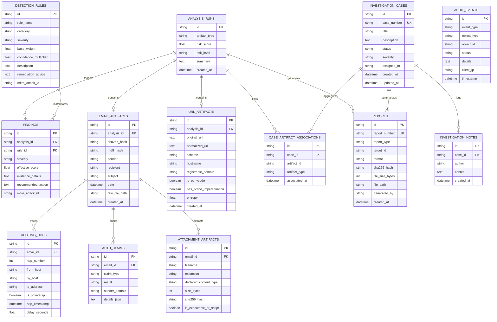

# Database Schema & Entity-Relationship Specification (DATABASE_SCHEMA.md)
## Project 04: Defensive Phishing Email & URL Threat Analysis Platform

---

### 1. Database Architecture & Engine Configuration

PhishGuard utilizes a relational architecture implemented on SQLite 3 with full migration support via Alembic.

#### Key Engine Pragmas:
- `PRAGMA journal_mode = WAL;` (Enables non-blocking concurrent readers during write transactions)
- `PRAGMA synchronous = NORMAL;` (Ensures durability while reducing disk I/O overhead)
- `PRAGMA foreign_keys = ON;` (Strict referential integrity enforcement on all foreign keys)
- `PRAGMA busy_timeout = 30000;` (30-second lock resolution threshold)

---

### 2. Entity-Relationship Diagram (Mermaid)

---

### 3. Comprehensive Table Specifications

#### 3.1 `analysis_runs`
| Column | Type | Constraints | Description |
| :--- | :--- | :--- | :--- |
| `id` | VARCHAR(36) | PRIMARY KEY | UUIDv4 analysis identifier. |
| `artifact_type` | VARCHAR(20) | NOT NULL | Target classification (`email` or `url`). |
| `risk_score` | FLOAT | NOT NULL | Calculated score normalized to $[0.0, 100.0]$. |
| `risk_level` | VARCHAR(20) | NOT NULL | Tier (`low`, `moderate`, `high`, `critical`). |
| `summary` | TEXT | NULLABLE | Serialized JSON summary metadata. |
| `created_at` | DATETIME | NOT NULL, DEFAULT UTC | Timestamp of scan initiation. |

#### 3.2 `email_artifacts`
| Column | Type | Constraints | Description |
| :--- | :--- | :--- | :--- |
| `id` | VARCHAR(36) | PRIMARY KEY | UUIDv4 email artifact identifier. |
| `analysis_id` | VARCHAR(36) | FK (`analysis_runs.id`), ON DELETE CASCADE | Associated analysis run. |
| `sha256_hash` | VARCHAR(64) | NOT NULL, INDEX | Cryptographic SHA-256 fingerprint of raw email. |
| `md5_hash` | VARCHAR(32) | NOT NULL | MD5 legacy tracking digest (`usedforsecurity=False`). |
| `sender` | VARCHAR(255) | NOT NULL | Extracted RFC 5322 `From:` address. |
| `recipient` | VARCHAR(255) | NOT NULL | Extracted RFC 5322 `To:` address. |
| `subject` | VARCHAR(500) | NOT NULL | Email subject line. |
| `date` | DATETIME | NULLABLE | RFC 5322 Date header converted to UTC. |
| `raw_file_path` | VARCHAR(500)| NULLABLE | Path to preserved `.eml` in `data/evidence/`. |
| `created_at` | DATETIME | NOT NULL, DEFAULT UTC | Ingestion timestamp. |

#### 3.3 `routing_hops`
| Column | Type | Constraints | Description |
| :--- | :--- | :--- | :--- |
| `id` | VARCHAR(36) | PRIMARY KEY | UUIDv4 hop identifier. |
| `email_id` | VARCHAR(36) | FK (`email_artifacts.id`), ON DELETE CASCADE | Parent email artifact. |
| `hop_number` | INTEGER | NOT NULL | Sequence index starting at 1 (originating MTA). |
| `from_host` | VARCHAR(255) | NOT NULL | Hostname specified in `from` clause. |
| `by_host` | VARCHAR(255) | NOT NULL | Receiving MTA hostname specified in `by` clause. |
| `ip_address` | VARCHAR(45) | NULLABLE | Extracted IPv4 or IPv6 address. |
| `is_private_ip` | BOOLEAN | NOT NULL, DEFAULT FALSE | Flag indicating RFC 1918 private address. |
| `hop_timestamp`| DATETIME | NULLABLE | Parsed UTC timestamp of relay event. |
| `delay_seconds` | FLOAT | NULLABLE | Calculated transit latency $\Delta t$ from previous hop. |

#### 3.4 `auth_claims`
| Column | Type | Constraints | Description |
| :--- | :--- | :--- | :--- |
| `id` | VARCHAR(36) | PRIMARY KEY | UUIDv4 claim identifier. |
| `email_id` | VARCHAR(36) | FK (`email_artifacts.id`), ON DELETE CASCADE | Parent email artifact. |
| `claim_type` | VARCHAR(10) | NOT NULL | `SPF`, `DKIM`, or `DMARC`. |
| `result` | VARCHAR(20) | NOT NULL | `pass`, `fail`, `softfail`, `neutral`, `none`. |
| `sender_domain`| VARCHAR(255) | NULLABLE | Sender domain claimed in auth header. |
| `details_json` | TEXT | NULLABLE | Serialized raw claim headers and audit notes. |

#### 3.5 `url_artifacts`
| Column | Type | Constraints | Description |
| :--- | :--- | :--- | :--- |
| `id` | VARCHAR(36) | PRIMARY KEY | UUIDv4 URL identifier. |
| `analysis_id` | VARCHAR(36) | FK (`analysis_runs.id`), ON DELETE CASCADE | Associated analysis run. |
| `original_url` | TEXT | NOT NULL | Raw input URL string. |
| `normalized_url`| TEXT | NOT NULL | RFC 3986 canonicalized URL string. |
| `scheme` | VARCHAR(20) | NOT NULL | Scheme (`http`, `https`, `ftp`). |
| `hostname` | VARCHAR(255) | NOT NULL, INDEX | Extracted authority hostname. |
| `registrable_domain`| VARCHAR(255)| NOT NULL | Offline PSL extracted domain (e.g. `example.com`). |
| `is_punycode` | BOOLEAN | NOT NULL, DEFAULT FALSE | Flag for `xn--` internationalized domains. |
| `has_brand_impersonation`| BOOLEAN| NOT NULL, DEFAULT FALSE | Flag for high-value target spoofing. |
| `entropy` | FLOAT | NOT NULL | Shannon entropy value of the hostname. |
| `created_at` | DATETIME | NOT NULL, DEFAULT UTC | Ingestion timestamp. |

#### 3.6 `attachment_artifacts`
| Column | Type | Constraints | Description |
| :--- | :--- | :--- | :--- |
| `id` | VARCHAR(36) | PRIMARY KEY | UUIDv4 attachment identifier. |
| `email_id` | VARCHAR(36) | FK (`email_artifacts.id`), ON DELETE CASCADE | Parent email artifact. |
| `filename` | VARCHAR(255) | NOT NULL | Sanitized attachment filename. |
| `extension` | VARCHAR(50) | NOT NULL | Normalized lowercase file extension. |
| `declared_content_type`| VARCHAR(100)| NOT NULL | MIME type declared in headers. |
| `size_bytes` | INTEGER | NOT NULL | Payload length in bytes. |
| `sha256_hash` | VARCHAR(64) | NOT NULL, INDEX | Cryptographic SHA-256 digest of payload. |
| `is_executable_or_script`| BOOLEAN| NOT NULL, DEFAULT FALSE | Binary/script execution risk indicator. |

#### 3.7 `detection_rules`
| Column | Type | Constraints | Description |
| :--- | :--- | :--- | :--- |
| `id` | VARCHAR(50) | PRIMARY KEY | Unique rule code (e.g. `URL-002`, `HDR-001`). |
| `rule_name` | VARCHAR(150) | NOT NULL | Human-readable rule title. |
| `category` | VARCHAR(50) | NOT NULL, INDEX | Threat category. |
| `severity` | VARCHAR(20) | NOT NULL | Default severity tier. |
| `base_weight` | FLOAT | NOT NULL | Base heuristic weight. |
| `confidence_multiplier`| FLOAT| NOT NULL, DEFAULT 1.0 | Statistical confidence coefficient. |
| `description` | TEXT | NOT NULL | Explanatory threat rationale. |
| `remediation_advice`| TEXT | NOT NULL | Recommended SOC analyst action. |
| `mitre_attack_id`| VARCHAR(20)| NULLABLE, INDEX | MITRE ATT&CK technique reference. |

#### 3.8 `findings`
| Column | Type | Constraints | Description |
| :--- | :--- | :--- | :--- |
| `id` | VARCHAR(36) | PRIMARY KEY | UUIDv4 finding instance. |
| `analysis_id` | VARCHAR(36) | FK (`analysis_runs.id`), ON DELETE CASCADE | Associated analysis run. |
| `rule_id` | VARCHAR(50) | FK (`detection_rules.id`) | Triggered detection rule. |
| `severity` | VARCHAR(20) | NOT NULL | Instantiated finding severity. |
| `effective_score`| FLOAT | NOT NULL | Scaled score contribution. |
| `evidence_details`| TEXT | NOT NULL | JSON evidence dictionary. |
| `recommended_action`| TEXT | NOT NULL | Remediation guidance. |
| `mitre_attack_id`| VARCHAR(20)| NULLABLE | MITRE ATT&CK reference. |

#### 3.9 `investigation_cases`
| Column | Type | Constraints | Description |
| :--- | :--- | :--- | :--- |
| `id` | VARCHAR(36) | PRIMARY KEY | UUIDv4 case identifier. |
| `case_number` | VARCHAR(50) | UNIQUE, NOT NULL, INDEX | Human-readable case tracking number. |
| `title` | VARCHAR(255) | NOT NULL | Case title. |
| `description` | TEXT | NULLABLE | Detailed investigation scope or incident trigger. |
| `status` | VARCHAR(20) | NOT NULL, DEFAULT 'open' | Case status (`open`, `in_review`, `resolved`). |
| `severity` | VARCHAR(20) | NOT NULL, DEFAULT 'medium'| Incident priority (`low`, `medium`, `high`, `critical`). |
| `assigned_to` | VARCHAR(100) | NULLABLE | Assigned analyst handle. |
| `created_at` | DATETIME | NOT NULL, DEFAULT UTC | Case creation timestamp. |
| `updated_at` | DATETIME | NOT NULL, DEFAULT UTC | Last status modification timestamp. |

#### 3.10 `investigation_notes`
| Column | Type | Constraints | Description |
| :--- | :--- | :--- | :--- |
| `id` | VARCHAR(36) | PRIMARY KEY | UUIDv4 note identifier. |
| `case_id` | VARCHAR(36) | FK (`investigation_cases.id`), ON DELETE CASCADE | Parent case. |
| `author` | VARCHAR(100) | NOT NULL | Analyst author. |
| `content` | TEXT | NOT NULL | Detailed observation or forensic notes. |
| `created_at` | DATETIME | NOT NULL, DEFAULT UTC | Entry timestamp. |

#### 3.11 `case_artifact_associations`
| Column | Type | Constraints | Description |
| :--- | :--- | :--- | :--- |
| `id` | VARCHAR(36) | PRIMARY KEY | UUIDv4 association identifier. |
| `case_id` | VARCHAR(36) | FK (`investigation_cases.id`), ON DELETE CASCADE | Target case. |
| `artifact_id` | VARCHAR(36) | NOT NULL, INDEX | Referenced artifact or run UUID. |
| `artifact_type`| VARCHAR(50) | NOT NULL | Type descriptor (`analysis_run`, `email`, `url`). |
| `associated_at`| DATETIME | NOT NULL, DEFAULT UTC | Correlation timestamp. |

#### 3.12 `reports`
| Column | Type | Constraints | Description |
| :--- | :--- | :--- | :--- |
| `id` | VARCHAR(36) | PRIMARY KEY | UUIDv4 report identifier. |
| `report_number`| VARCHAR(50) | UNIQUE, NOT NULL, INDEX | Human-readable tracking number (`REP-...`). |
| `report_type` | VARCHAR(50) | NOT NULL | `analysis_run` or `investigation_case`. |
| `target_id` | VARCHAR(36) | NOT NULL | Referenced entity UUID. |
| `format` | VARCHAR(10) | NOT NULL | `pdf`, `csv`, `json`, or `stix`. |
| `sha256_hash` | VARCHAR(64) | NOT NULL | Cryptographic digest of exported file. |
| `file_size_bytes`| INTEGER | NOT NULL | Byte length of exported artifact. |
| `file_path` | VARCHAR(500)| NOT NULL | On-disk path in `data/reports/`. |
| `generated_by` | VARCHAR(100)| NOT NULL, DEFAULT 'system' | Generating analyst or service. |
| `created_at` | DATETIME | NOT NULL, DEFAULT UTC | Generation timestamp. |

#### 3.13 `audit_events`
| Column | Type | Constraints | Description |
| :--- | :--- | :--- | :--- |
| `id` | VARCHAR(36) | PRIMARY KEY | UUIDv4 audit event identifier. |
| `event_type` | VARCHAR(50) | NOT NULL, INDEX | Action descriptor (`analysis_executed`, `case_created`). |
| `object_type` | VARCHAR(50) | NOT NULL | Target table/model classification. |
| `object_id` | VARCHAR(36) | NOT NULL, INDEX | Target entity identifier. |
| `status` | VARCHAR(20) | NOT NULL | Event outcome (`success`, `failure`). |
| `details` | TEXT | NOT NULL | Structured JSON event metadata. |
| `client_ip` | VARCHAR(45) | NOT NULL | Request originating IP address. |
| `timestamp` | DATETIME | NOT NULL, DEFAULT UTC, INDEX | Chronological audit timestamp. |

#### 3.14 `dkim_dns_records`
| Column | Type | Constraints | Description |
| :--- | :--- | :--- | :--- |
| `id` | VARCHAR(64) | PRIMARY KEY | Unique record identifier (`dkim_rec_...`). |
| `domain` | VARCHAR(255) | NOT NULL, INDEX | Target domain for DKIM signing (e.g. `paypal.com`). |
| `selector` | VARCHAR(64) | NOT NULL, INDEX | DKIM selector (e.g. `s1`, `202601`). |
| `public_key_txt` | TEXT | NOT NULL | Raw DNS TXT record containing RSA public key (`v=DKIM1; p=...`). |
| `source_snapshot`| VARCHAR(255) | NOT NULL | Originating zone snapshot filename or identifier. |
| `imported_at` | VARCHAR(32) | NOT NULL | ISO UTC import timestamp. |
| `notes` | TEXT | NULLABLE | Analyst provenance or operational notes. |
| *Composite* | UNIQUE INDEX | `(domain, selector)` | Prevents duplicate selector entries per domain. |

