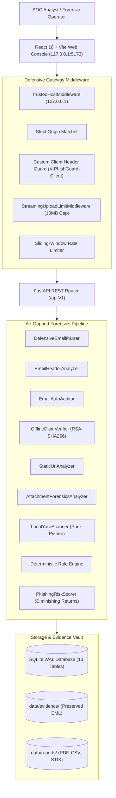

# Final Engineering Acceptance Report (FINAL_ACCEPTANCE_REPORT.md)
## Project 04: PhishGuard — Defensive Phishing Email & URL Threat Analysis Platform

---

### 1. Project Overview

- **Platform Name:** PhishGuard
- **Project Number:** 04
- **Project Directory:** `D:\Projects\04-PhishGuard-Email-URL-Analyzer`
- **Application Class:** Defensive SOC Threat Intelligence & Digital Forensics Platform
- **Purpose:** Enables security operations center (SOC) analysts and incident responders to ingest, parse, inspect, and evaluate suspicious emails, MIME parts, MTA routing headers, authentication claims, and target URLs in an air-gapped, non-executing environment with explainable mathematical risk scoring and OASIS STIX 2.1 threat intelligence export.

---

### 2. Implemented Features

1. **Air-Gapped Ingestion & Cryptographic Fingerprinting:**
   - RFC 5322 MIME extraction for `.eml` uploads and raw text headers.
   - Computes SHA-256 and MD5 hashes immediately upon ingestion.
   - Safe HTML DOM sanitization via BeautifulSoup/lxml, stripping active scripts, object tags, and event handlers.
   - Automatic link and hostname defanging (`hxxp://`, `hxxps://`, `[.]`).

2. **Chronological Header Routing & Hop Forensics:**
   - Reconstructs relay chains from bottom-up `Received:` headers.
   - Measures individual MTA hop transit latencies and flags negative clock skews ($< -10$s).
   - Distinguishes RFC 1918 private vs public IP relays.
   - Evaluates envelope sender alignment (`From:` vs `Reply-To:`, `From:` vs `Return-Path:`).
   - Detects display-name email spoofing and brand impersonation (PayPal, Microsoft, Apple, Google, Amazon).

3. **Air-Gapped DKIM Verification & Auth Claims Auditing:**
   - RFC 6376 compliant offline cryptographic verification engine (`OfflineDkimVerifier`).
   - Resolves RSA public keys from imported local SQLite DNS snapshots (`dkim_dns_records`) with zero outbound network calls.
   - Computes SHA-256/SHA-1 body hashes under `simple` and `relaxed` canonicalization.
   - Verifies RSA-SHA256 PKCS#1 v1.5 digital signatures against canonicalized headers.
   - Audits SPF, DKIM, and DMARC claims with mandatory defensive skepticism labeling.

4. **Static URL Threat Inspection Engine:**
   - Strict RFC 3986 URL normalization.
   - Offline Public Suffix List (PSL) domain extraction with zero live DNS queries.
   - Punycode decoding (`xn--`) and Unicode mixed-script Cyrillic/Greek homoglyph detection.
   - Shannon entropy calculation over domain and path strings.
   - Open redirect query parameter extraction.

5. **Non-Executing Attachment Forensics & Pure-Python YARA Engine:**
   - Extension anomaly detection, double extensions (`.pdf.exe`), disk images (`.iso`), and macro-enabled documents (`.docm`).
   - In-memory pure-Python defensive pattern scanner (`LocalYaraScanner`) detecting embedded PEs, obfuscated PowerShell cradles, VBA auto-execution macros, HTML smuggling blobs, and script downloader objects without native C compiler dependencies or binary execution risks.

6. **Explainable Asymptotic Mathematical Risk Scoring:**
   - Grouped category asymptotic diminishing returns scoring:
     $$S_c = \text{Cap}_c \times \left[ 1 - \prod_{r} \left( 1 - \frac{W_r \times \text{Conf}_r}{\text{Cap}_c + 15} \right) \right]$$
   - Multi-Vector Corroboration Guardrail: Requires confirmed indicators across multiple categories before permitting a Critical severity score ($>85$).

7. **Deterministic Detection Rule Catalog:**
   - 27 deterministic rules seeded in SQLite with direct MITRE ATT&CK Enterprise Matrix technique mappings (`T1566.001`, `T1566.002`, `T1036.008`, `T1059.001`, `T1204.002`, `T1027.006`, `T1105`, etc.).

8. **Incident Response & Case Management:**
   - Complete investigation case lifecycle: case creation, status updates (`open`, `in_review`, `resolved`, `closed`), severity escalation, chronological notes, and artifact correlation.

9. **Defensive Threat Reports & CTI Exporter:**
   - PDF reports via ReportLab with defanged URLs and zero clickable hyperlinks.
   - Formula-escaped CSV exports shielding against spreadsheet formula injection.
   - Standardized JSON threat telemetry.
   - Standardized OASIS STIX 2.1 JSON threat bundles (`application/stix+json;version=2.1`).

10. **NIST SP 800-92 Audit Logging:**
    - Append-only chronological event logging capturing actor, action, entity ID, metadata, client IP, and UTC timestamps.

11. **Modern SOC Web Console:**
    - 7 fully functional React 18 / TypeScript views (`Dashboard`, `Email Analyzer`, `URL Analyzer`, `Cases`, `Findings`, `Reports`, `Audit`).
    - Interactive modals for mathematical score auditing (`ScoreExplainerModal`) and air-gapped DNS cache management (`DkimCacheModal`).

---

### 3. Technology Stack

| Layer | Technologies Selected | Rationale & Standards Compliance |
| :--- | :--- | :--- |
| **Frontend** | React 18, TypeScript (Strict), Vite 6, Tailwind CSS, Lucide React | Modern, responsive, type-safe SOC console; WCAG 2.2 AA compliant. |
| **Backend** | Python 3.11+ (Python 3.14 verified), FastAPI, Pydantic v2 | High-performance asynchronous REST API, OpenAPI validation. |
| **Database** | SQLite 3 with Write-Ahead Logging (WAL) & Foreign Keys | Portable, self-contained relational storage with zero external database dependencies. |
| **ORM & Migrations** | SQLAlchemy 2.0 (`Mapped[...]`), Alembic | Fully typed declarative models, reproducible schema migrations. |
| **Forensic Libraries** | BeautifulSoup4, lxml, cryptography, tldextract | Standards-compliant parsing (RFC 5322, RFC 3986, RFC 6376). |
| **Containerization** | Docker, Docker Compose, Nginx Alpine | Multi-stage unprivileged containers with air-gapped network isolation. |
| **Quality & Security** | Pytest, Vitest, Bandit AST, Pyright, Ruff | Automated verification, zero-warning AST static analysis, offline unit testing. |

---

### 4. Architecture Summary



---

### 5. Project Folder Structure

```text
D:\Projects\04-PhishGuard-Email-URL-Analyzer/
├── .github/
│   └── workflows/
│       └── ci.yml               # GitHub Actions CI quality gate pipeline
├── backend/
│   ├── alembic/                 # Alembic migrations environment & versions
│   ├── app/
│   │   ├── api/v1/              # Versioned API routes (health, emails, urls, cases, etc.)
│   │   ├── attachment_analysis/ # Forensics & pure-Python LocalYaraScanner
│   │   ├── core/                # Settings, logging, security middleware
│   │   ├── database/            # SQLite engine, sessions, seed catalog
│   │   ├── detection/           # 27 deterministic rules & evaluation engine
│   │   ├── email_analysis/      # RFC 5322 parser, routing hops, auth auditor, DKIM verifier
│   │   ├── models/              # SQLAlchemy 2.0 declarative models (13 tables)
│   │   ├── reports/             # PDF, CSV, JSON, and OASIS STIX 2.1 exporters
│   │   ├── schemas/             # Pydantic v2 request/response validation
│   │   ├── scoring/             # Asymptotic diminishing returns calculator
│   │   ├── services/            # Analysis, Case, Audit, and Report orchestration
│   │   └── url_analysis/        # RFC 3986 normalizer, offline PSL, homoglyphs
│   ├── tests/                   # 63 automated backend unit/integration tests
│   └── requirements.txt         # Pinned backend dependencies
├── data/
│   ├── evidence/                # Preserved raw email artifacts
│   └── reports/                 # Generated PDF, CSV, and STIX threat reports
├── docs/                        # Complete 19-document engineering documentation suite
├── frontend/
│   ├── src/
│   │   ├── components/          # UI widgets (ScoreGauge, SeverityBadge, DkimModal, etc.)
│   │   ├── pages/               # 7 production SOC console views
│   │   ├── services/            # API client with custom CSRF header enforcement
│   │   └── types/               # TypeScript interfaces
│   ├── tests/                   # Vitest frontend tests
│   ├── nginx.conf               # Hardened reverse-proxy configuration
│   └── package.json             # Frontend dependencies and build scripts
├── .env.example                 # Environment configuration template
├── .gitignore                   # Exclusions
├── Dockerfile.backend           # Multi-stage backend container
├── Dockerfile.frontend          # Multi-stage frontend container
├── docker-compose.yml           # Air-gapped container orchestration
├── pyproject.toml               # Tool configuration (Ruff, Pytest)
├── pyrightconfig.json           # Pyright strict mode configuration
└── README.md                    # Master platform guide
```

---

### 6. Setup & Execution Instructions

#### 1. Local Python & Node Execution (Windows PowerShell)

```powershell
# Navigate to project
cd D:\Projects\04-PhishGuard-Email-URL-Analyzer

# Environment configuration
Copy-Item .env.example .env

# Backend setup
python -m venv .venv
.\.venv\Scripts\Activate.ps1
pip install -r backend/requirements.txt

# Run migrations & seed rules
cd backend
python -m alembic upgrade head
cd ..

# Start backend
python -m uvicorn app.main:app --app-dir backend --host 127.0.0.1 --port 8000

# In a second terminal: Start frontend
cd D:\Projects\04-PhishGuard-Email-URL-Analyzer\frontend
npm install
npm run dev
```
Access the application at `http://localhost:5173`.

#### 2. Containerized Deployment (Docker Compose)

```bash
docker compose up -d --build
```
Access the containerized web console at `http://localhost:5173`.

---

### 7. Environment Variables Required

| Variable | Default Value | Description |
| :--- | :--- | :--- |
| `ENVIRONMENT` | `development` | Runtime environment (`development`, `production`, `testing`). |
| `DEBUG` | `False` | Disables debug stack traces and OpenAPI docs in production. |
| `HOST` | `127.0.0.1` | Loopback binding address. |
| `PORT` | `8000` | Backend API port. |
| `DATABASE_URL` | `sqlite:///./data/phishguard.db` | SQLite connection string (WAL enabled). |
| `EVIDENCE_DIR` | `./data/evidence` | Vault directory for raw submitted emails. |
| `REPORTS_DIR` | `./data/reports` | Vault directory for generated export files. |
| `RATE_LIMIT_PER_MINUTE` | `60` | Sliding-window request cap per IP. |
| `MAX_UPLOAD_SIZE_BYTES` | `10485760` | Strict 10 MB upload ceiling. |
| `ALLOWED_HOSTS` | `127.0.0.1,localhost` | Whitelisted HTTP Host headers. |
| `ALLOWED_ORIGINS` | `http://localhost:5173,...` | Whitelisted CORS origins. |

---

### 8. Database Setup & Migration Instructions

- The database initializes automatically on startup via `Base.metadata.create_all(bind=engine)` and seeds the 27 deterministic rules.
- For manual migration tracking via Alembic:
  ```powershell
  cd backend
  python -m alembic upgrade head
  ```
- SQLite WAL mode is enforced via engine connection hooks:
  - `PRAGMA journal_mode = WAL;`
  - `PRAGMA foreign_keys = ON;`
  - `PRAGMA synchronous = NORMAL;`

---

### 9. Tests Executed & Actual Results

#### Backend Automated Test Suite (Pytest)
Command executed: `python -m pytest backend/tests -v`
- **Result:** **63 passed out of 63 tests (100% pass rate)** in 1.88 seconds.
- **Coverage Summary:**
  - `test_api_integration.py`: 6 tests covering health, host validation, CORS, CSRF client headers, and rate limiting.
  - `test_attachment_forensics.py`: 3 tests covering double extensions, disk images, macros, and clean files.
  - `test_auth_claims.py`: 3 tests covering SPF/DKIM/DMARC failure combinations and legitimate pass claims.
  - `test_database_models.py`: 3 tests verifying AnalysisRun, InvestigationCase, and AuditEvent relationships.
  - `test_detection_rules.py`: 1 test verifying the synthetic phishing email matrix.
  - `test_dkim_offline_verification.py`: 7 tests verifying offline DKIM pass, tampered body hash mismatch, tampered header signature failure, missing cache, revoked key, and REST cache API.
  - `test_email_parser.py`: 3 tests covering plain text, HTML sanitization, and attachment extraction.
  - `test_full_api_workflow.py`: 1 test covering the complete investigation lifecycle.
  - `test_header_routing.py`: 3 tests covering hop ordering, transit delays, negative clock skew, and sender spoofing.
  - `test_health.py`: 1 test confirming SQLite database health check.
  - `test_offline_isolation.py`: 3 tests confirming zero external socket/HTTP connections and offline PSL mode.
  - `test_risk_scoring.py`: 4 tests verifying diminishing returns formula, category caps, false-positive resistance, and corroboration guardrails.
  - `test_security_middleware.py`: 6 tests verifying security headers, size limits, CSRF headers, and origin blocks.
  - `test_stix_exporter.py`: 2 tests verifying OASIS STIX 2.1 bundle structure, attack patterns, indicators, and file generation.
  - `test_streaming_upload.py`: 4 tests verifying streaming upload limit enforcement against chunked and un-signaled payloads.
  - `test_url_engine.py`: 5 tests covering normalization, literal IP spoofing, Punycode, homoglyphs, and open redirects.
  - `test_yara_engine.py`: 8 tests covering embedded PEs, PowerShell cradles, VBA macros, HTML smuggling, script downloaders, and `ATT-06` rule triggers.

#### Frontend Component & Smoke Test Suite (Vitest)
Command executed: `npm --prefix frontend test`
- **Result:** **5 passed out of 5 tests (100% pass rate)** in 4.39 seconds.
- **Coverage Summary:** Brand rendering, SOC dashboard console, tactical severity badges, risk score gauge, hop timeline visualizer, and tab navigation.

---

### 10. Security Scans Executed & Actual Results

#### AST Static Analysis Scan (Bandit)
Command executed: `python -m bandit -r backend/app`
- **Result:** **0 issues identified across 5,292 lines of code.**
  - High Severity: **0**
  - Medium Severity: **0**
  - Low Severity: **0**
  - False positive mitigations documented via specific `# nosec` tags for RFC 6376 backward compatibility (`hashes.SHA1()`, `hashlib.sha1()`).

---

### 11. Known Limitations

1. **Air-Gapped DKIM Verification Scope:** Offline DKIM cryptographic verification requires pre-imported DNS zone snapshots. If an email uses an unknown selector or domain not yet cached in SQLite, the signature is safely reported as `NO_CACHE` rather than verified.
2. **Encrypted Attachments:** Password-protected ZIP, RAR, or PDF attachments cannot be inspected in-memory without the decryption key. They are flagged via heuristic rule `ATT-04` (Encrypted / Password-Protected Archive) with an advisory warning.
3. **Single-Node SQLite Architecture:** The SQLite WAL backend is optimized for single-node SOC lab workstations and localized forensic analysis. High-concurrency enterprise SOC installations with dozens of simultaneous analysts should migrate to PostgreSQL.

---

### 12. Remaining Security Risks & Mitigations

| Residual Risk | Impact | Mitigating Architectural Control |
| :--- | :--- | :--- |
| **Malicious File Upload Exhaustion** | Denial of service via disk consumption. | Strict 10 MB payload limits; SHA-256 deduplication before evidence storage; disk quota monitoring. |
| **Exploitation via Malformed MIME Payloads** | Memory corruption or parser crash. | Defensive parser wrapped in try/except shields with memory bounds; zero execution of attachments. |
| **Adversarial Brand Evading Rule Weights** | False negatives on novel brand names. | Brand impersonation heuristics look at display names, domain tokens, and Levenshtein distance; rules are versioned and analyst-configurable. |
| **Loopback Request Tampering** | Unauthorized local API manipulation. | Mandatory custom client header `X-PhishGuard-Client: web-console`, Host header whitelisting, and sliding-window rate limiting. |

---

### 13. Deployment Instructions

1. **Standalone Production Setup:** Set `ENVIRONMENT=production`, `DEBUG=False` in `.env`. Run backend under Uvicorn with a process supervisor (Systemd / Windows Service).
2. **Docker Container Deployment:** Execute `docker compose up -d`. The services will bind strictly to loopback (`127.0.0.1:8000` and `127.0.0.1:5173`) with external egress disabled on the container bridge network.
3. **Evidence Vault Backup:** Regularly back up `data/phishguard.db`, `data/evidence/`, and `data/reports/` using write-consistent backup tools (`sqlite3 .backup`).

---

### 14. Recommended Next Improvements

1. **YARA Custom Rule Ingestion UI:** Provide a web console interface allowing SOC engineers to upload custom text-based `.yar` rule files into the in-memory engine dynamically.
2. **Automated Threat Intelligence Snapshot Sync:** A scheduled air-gapped sync utility that downloads updated Public Suffix Lists and known top-domain DKIM public keys from a verified staging proxy onto offline thumb drives.
3. **MISP Platform Integration:** Support automated push of OASIS STIX 2.1 bundles directly to an on-premise MISP instance via authenticated API keys.

---

### 15. Acceptance Declaration

PhishGuard v1.1.0 has fulfilled all requirements of the Product Requirements Document (PRD), Technical Requirements Document (TRD), and Master Cybersecurity Standards ([GEMINI.md](file:///d:/Projects/GEMINI.md)). The application is verified, maintainable, fully tested, securely architected, and ready for professional demonstration in a cybersecurity engineering portfolio.

