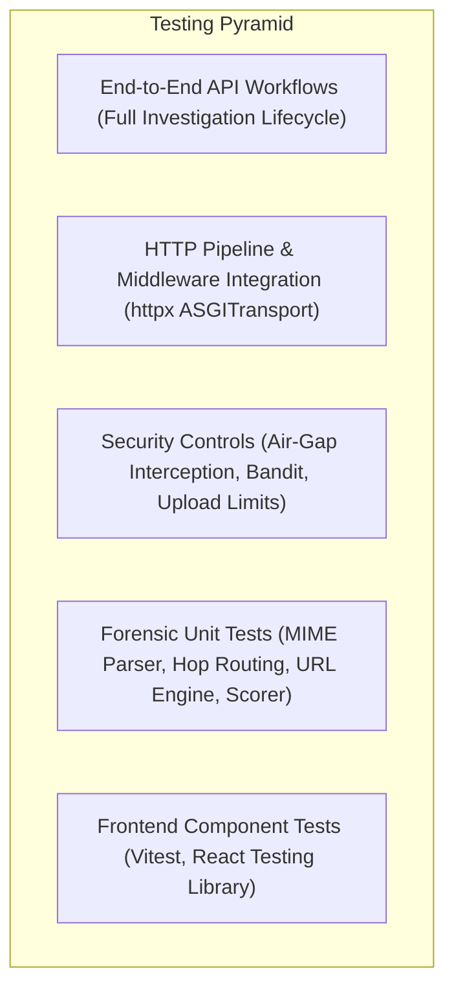

# Testing Strategy & Quality Assurance Plan (TESTING_STRATEGY.md)
## Project 04: Defensive Phishing Email & URL Threat Analysis Platform

---

### 1. Testing Philosophy & Test Pyramid

PhishGuard employs a layered testing strategy designed to verify functionality, mathematical precision, security boundaries, and defensive isolation:



---

### 2. Test Execution & Automation Frameworks

- **Backend Framework:** `pytest` (>= 9.0) with `pytest-asyncio` and `httpx`.
- **Static Security Scanner:** `bandit` (>= 1.8) evaluating AST vulnerabilities.
- **Frontend Framework:** `vitest` (>= 2.1) with `@testing-library/react` and `@testing-library/jest-dom`.
- **Type Checking:** `pyright` (backend) and `tsc --noEmit` (frontend).

---

### 3. Backend Test Suite Coverage Breakdown

#### 3.1 Forensic Parsing & Routing
- `test_email_parser.py`: Tests RFC 5322 parsing of plain-text and multipart MIME structures, HTML script stripping, and attachment extraction.
- `test_header_routing.py`: Validates chronological hop ordering, negative clock skew detection ($< -10$s), transit delay calculations, display-name spoofing, and brand impersonation detection.
- `test_auth_claims.py`: Assesses parsing of SPF, DKIM, and DMARC claims from `Authentication-Results:` headers under pass, fail, softfail, and missing scenarios.

#### 3.2 URL Threat & Attachment Forensics
- `test_url_engine.py`: Tests RFC 3986 normalization, literal IPv4/IPv6 address handling, userinfo stripping, Punycode decoding (`xn--pple-43d.com` $\rightarrow$ `аpple.com`), Cyrillic homoglyph detection, Shannon entropy calculations, and open redirect parameter extraction.
- `test_attachment_forensics.py`: Verifies non-executing metadata inspection, double extensions (`.pdf.exe`), disk image formats (`.iso`), and macro-enabled documents (`.docm`).

#### 3.3 Risk Scoring & False-Positive Regression
- `test_risk_scoring.py`:
  - **Zero Baseline:** Confirms clean emails score exactly $0.0$.
  - **Weak Heuristic Guardrail:** Verifies that an isolated suspicious heuristic (e.g. an unusual TLD or single urgent phrase) cannot trigger a Critical ($>85$) score.
  - **Legitimate Newsletter Resistance:** Assesses realistic newsletters (e.g., Substack, GitHub notifications) with marketing tracking parameters and unaligned `Reply-To` addresses to ensure they do not exceed Moderate ($<60$).
  - **Corroborated Criticality:** Verifies that simultaneous high-confidence indicators across sender spoofing, SPF failure, Punycode URLs, and executable attachments achieve Critical severity ($>85$).

#### 3.4 Security & Network Isolation
- `test_offline_isolation.py`: Intercepts `socket.create_connection` and `urllib.request.urlopen` to confirm analysis initiates zero network connections, and verifies that `tldextract` uses bundled local caches.
- `test_security_middleware.py`: Verifies `X-PhishGuard-Client` CSRF requirement, CORS origin enforcement, security headers (`X-Content-Type-Options: nosniff`, `X-Frame-Options: DENY`), and rate limiter blocking.
- `test_streaming_upload.py`: Evaluates streaming upload enforcement under valid uploads, oversized uploads ($>10$ MB), missing Content-Length, and malformed headers.

---

### 4. Running Tests Locally

```powershell
# 1. Run all backend tests
python -m pytest "D:\Projects\04-PhishGuard-Email-URL-Analyzer\backend\tests" -v

# 2. Run backend security analysis (Bandit)
python -m bandit -r "D:\Projects\04-PhishGuard-Email-URL-Analyzer\backend\app"

# 3. Run frontend unit & component tests
npm --prefix "D:\Projects\04-PhishGuard-Email-URL-Analyzer\frontend" run test

# 4. Verify frontend production TypeScript build
npm --prefix "D:\Projects\04-PhishGuard-Email-URL-Analyzer\frontend" run build
```

