# Threat Model & STRIDE Analysis (THREAT_MODEL.md) — PhishGuard
## Project 04: Defensive Phishing Email & URL Threat Analysis Platform

---

### 1. Threat Modeling Scope & Trust Boundaries

The threat model evaluates the PhishGuard application boundaries, processing components, and persistence stores when ingesting actively hostile phishing artifacts.

```mermaid
flowchart LR
    subgraph UntrustedZone["Untrusted External Zone"]
        MaliciousActor["Adversary / Threat Actor"]
        HostileEmail["Hostile .eml / Phishing Email"]
        HostileUrl["Obfuscated / Homoglyph URL"]
    end

    subgraph TrustBoundary1["Trust Boundary 1: Ingestion Gateway"]
        API["FastAPI Loopback Endpoint (127.0.0.1)"]
        StreamLimiter["10MB Stream Limiter"]
        CSRF["X-PhishGuard-Client Filter"]
    end

    subgraph TrustBoundary2["Trust Boundary 2: Air-Gapped Forensics Engine"]
        Sanitizer["BeautifulSoup lxml Sanitizer"]
        HopParser["Header Hop Analyzer"]
        UrlEngine["Offline PSL Static Analyzer"]
        AttachInspector["In-Memory Attachment Fingerprinter"]
    end

    subgraph TrustBoundary3["Trust Boundary 3: Evidence & Audit Vault"]
        SQLite[("SQLite 3 DB (Strict FKs)")]
        EvidenceDir[("data/evidence/ (Restricted Permissions)")]
        ReportsDir[("data/reports/ (Defanged Artifacts)")]
    end

    HostileEmail -->|HTTP Upload| TrustBoundary1
    HostileUrl -->|JSON Post| TrustBoundary1
    TrustBoundary1 -->|Validated Bytes| TrustBoundary2
    TrustBoundary2 -->|Defanged Records| TrustBoundary3
```

---

### 2. Assets & Security Objectives

| Asset | Criticality | Primary Threat | Core Defense |
| :--- | :--- | :--- | :--- |
| **Evidence Vault (`data/evidence/`)** | High | Tampering, unauthorized deletion | SHA-256 integrity digest stored in DB upon ingestion; restricted filesystem ACLs. |
| **Air-Gap Guarantee** | Critical | Information disclosure / Canary triggering | Complete removal of DNS and socket resolution during analysis. |
| **Analyst Client Host** | Critical | Code execution via attachment or link click | Inert defanging (`hxxp://`), zero attachment execution, sanitized HTML preview. |
| **Audit Log (`audit_events`)** | High | Repudiation, audit record tampering | Append-only SQLite schema; all mutations logged chronologically. |
| **Report Consumers** | Medium | CSV formula injection, malicious PDF links | Prepending `'` to dangerous CSV characters; ReportLab defanged canvas rendering. |

---

### 3. STRIDE Threat Analysis Matrix

| Category | Threat Description | Attack Vector | Technical Countermeasure | Residual Risk |
| :--- | :--- | :--- | :--- | :--- |
| **Spoofing (S)** | Attacker submits email with fake upstream `Authentication-Results: pass` to trick analysts into dismissing a phishing attack. | Fabricated upstream auth headers in multipart MIME payload. | All parsed auth headers are strictly labeled `"Unverified Header Claim"` and evaluated alongside hop headers and sender alignment. | **LOW** |
| **Spoofing (S)** | Attacker uses Cyrillic/Greek characters or Punycode (`xn--`) to spoof high-profile brands (e.g., Apple, PayPal). | Lookalike homoglyphs in target URL. | `StaticUrlAnalyzer` decodes Punycode to Unicode and checks character scripts for mixed Cyrillic/Latin homoglyphs. | **LOW** |
| **Tampering (T)** | Attacker attempts directory traversal to overwrite or delete host configuration files. | Path traversal payloads (`../../etc/passwd`) in filename or report request. | Filenames are hashed and assigned UUIDs; `os.path.commonpath` verifies report retrieval cannot escape `data/reports/`. | **LOW** |
| **Repudiation (R)** | Analyst modifies case severity or deletes evidence without an audit trail. | Unlogged API state modifications. | All case status updates, note additions, and report exports record the client IP, timestamp, and payload in `audit_events`. | **LOW** |
| **Information Disclosure (I)** | Ingestion of email triggers outbound DNS lookup or HTTP request, alerting adversary that campaign is under SOC analysis. | Remote tracking pixels (``) or DNS prefetch headers. | Zero-outbound network guarantee enforced by socket blocking; BeautifulSoup strips ``, `<link>`, and prefetch tags. | **NEGLIGIBLE** |
| **Denial of Service (D)** | Attacker streams multi-gigabyte upload or chunked stream to exhaust host RAM. | Oversized multipart upload stream. | `StreamingUploadLimitMiddleware` rejects $>10$ MB uploads immediately via `Content-Length` or byte-counting stream wrapper. | **LOW** |
| **Elevation of Privilege (E)**| Analyst opens exported CSV report in Microsoft Excel, executing malicious system command via DDE. | Phishing subject containing `=cmd|'/C calc'!A0` or `@SUM(...)`. | `CsvReportExporter` prepends a single quote (`'`) to any cell beginning with `=`, `+`, `-`, `@`, `\t`, or `\r`. | **NEGLIGIBLE** |
| **Elevation of Privilege (E)**| Executable attachment (`.exe`, `.scr`, `.vbs`, `.iso`) executes during ingestion. | Accidental execution during attachment parsing. | `AttachmentForensicsAnalyzer` evaluates bytes in memory without saving to executable path; no sub-processes are invoked. | **NEGLIGIBLE** |

